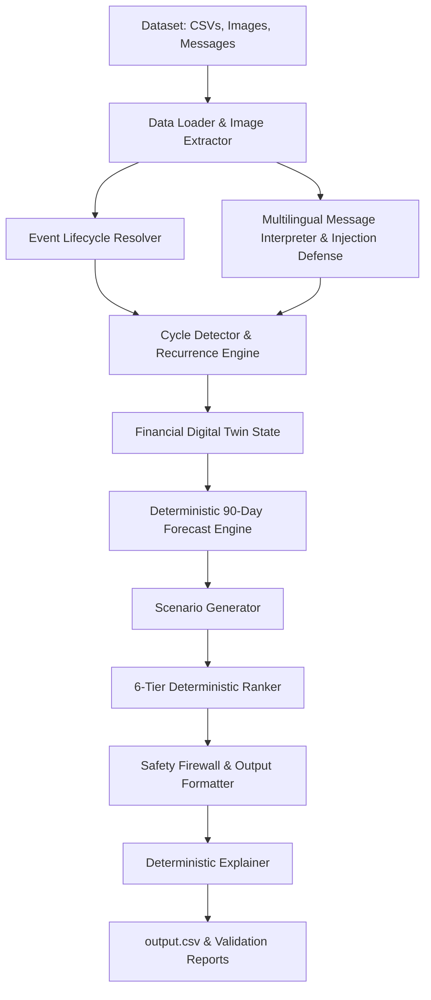

# FinCredTwin — Buy or Wait? Financial Decision Agent

**HackerRank Orchestrate (September 2026) Challenge Submission**  
**Repository**: https://github.com/harishpranav2006-cmyk/fincredtwin-ai-financial-agent  

---

## 1. System Overview

**FinCredTwin** is a deterministic, AI-powered financial intelligence system designed to answer the fundamental question: **"Can I afford this expense, or should I wait?"**

By reconstructing an individualized **Financial Digital Twin** from historical events, pending transactions, recurring commitments, employer payrolls, fixed exchange rates, and unstructured messages/images, FinCredTwin simulates future cash balances across a 90-day forward forecast horizon. It identifies the safest, most cost-effective recommendation that guarantees the user's balance never breaches their protected minimum balance threshold.

### Core Capabilities:
- **Financial Cycle Identification**: Automated detection of monthly fixed recurring commitments (rent, utilities, debt, subscriptions) with strict calendar-monthly day pinning and leap-year handling.
- **EMI & Obligation Tracking**: Comprehensive accounting for loans, debts, and structured installment commitments across multiple providers.
- **Income Verification & Stream Segregation**: Independent tracking of primary payroll, secondary household income, gig platform payouts, and freelance invoices without conflating one-off spikes or unconfirmed bonuses.
- **Evidence Resolution**: Ground-truth resolution of missing event amounts from visual media with provenance tracking, alongside multilingual (English/Indonesian) rule-based message interpretation.
- **Financial Digital Twin**: High-fidelity state model encapsulating current balance, liquid headroom, protected priority categories, and user-specified payment preferences.
- **Counterfactual Financial Simulation**: Day-by-day 91-point balance simulation ($t \in [0, 90]$) evaluating competing payment options under alternative spending adjustments.
- **Deterministic 90-Day Safety Firewall**: Mathematical verification ensuring closing balances $B(t) \ge \text{minimum\_balance\_to\_keep}$ for all days.
- **Official Payment-Plan Ranking**: 6-tier lexicographical comparator (deadline satisfaction > no spending changes > lowest total cost > earliest start date > fewest payments).

---

## 2. Core HackerRank Logic vs. SIH-Inspired Supporting Concepts

To maintain strict compliance with the competition contract and avoid unsupported claims, the codebase clearly demarcates **Core Challenge Requirements** from **SIH-Inspired Supporting Concepts**:

| Dimension | Core HackerRank Challenge Logic | SIH-Inspired Architectural Inspirations |
|---|---|---|
| **Authoritative Scope** | **Active & Evaluated**: Solves all 250 requests in `dataset/requests.csv` writing `output.csv`. | **Conceptual Background**: Structural design paradigms from high-reliability fintech systems. |
| **Financial State Modeling** | Digital twin of account balance, headroom, minimum balance, and essential categories. | General holistic digital twin concepts for long-term financial health. |
| **Credit Scoring & Utilization** | **Not in Dataset**: The competition dataset does *not* contain credit bureau scores, credit card utilization rates, or external lending metrics. FinCredTwin strictly avoids inventing or relying on unsupported credit scores. | Inspired loan-utilization tracking and beneficiary credit scoring are acknowledged as separate, external fintech domains and are **not** claimed as active core features. |
| **Cash Inflows & Verification** | Strictly counts confirmed salary on settlement date. Ignores pending credits, unapproved commissions, and lottery claims (§6.3). | Verification frameworks inspired by multi-source evidence reconciliation. |
| **Decision Space** | Categorical outputs (`affordable_now`, `affordable_with_plan`, `affordable_later`, `not_affordable`) and 5 methods (`full_payment`, `partial_payment`, `installments`, `wait`, `not_recommended`). | Automated intervention recommendations. |

---

## 3. Architecture & Pipeline



1. **`code/data_loader.py`**: Loads structured CSVs, parses dates and currencies, fills missing transaction amounts from verified image provenance cache.
2. **`code/event_lifecycle.py`**: Enforces strict cash accounting rules (`settled`, `pending`, `scheduled`, `unrealized`). Prevents counting unrealized investments as liquid cash.
3. **`code/message_interpreter.py`**: 20+ multilingual regex extraction rules for English and Indonesian. Quarantines prompt injection attacks (`ignore previous instructions`, `bypass minimum balance`).
4. **`code/cycle_detector.py`**: Robust cycle detection with calendar-monthly day pinning, leap-year handling, and distinct income stream segregation.
5. **`code/financial_state.py`**: Instantiates `FinancialDigitalTwin` with balance, minimum balance to keep, headroom, and priority categories.
6. **`code/forecast_engine.py`**: Simulates 91 daily closing balances. Calculates safe payment amounts via minimum headroom and verifies via simulation.
7. **`code/scenario_generator.py`**: Generates valid candidate plans across all 5 payment methods and candidate spending reductions.
8. **`code/ranker.py`**: Official 6-tier deterministic tuple comparator.
9. **`code/safety_firewall.py`**: Final output validation gate ensuring invariant satisfaction and formatting precision.
10. **`code/explainer.py`**: Template-based, grounded explanations using natural date formatting (`15 September 2024`).

---

## 4. Verification & Performance

### Test Suite
Run the comprehensive test suite (38 unit, invariant & adversarial tests):
```bash
python -m unittest discover -s tests -v
```
All 38 tests execute in **0.004 seconds**, verifying:
- Multi-debt obligation recurrence stream segregation (independent loan cycles)
- Distinguishable obligations under the same lender / same category
- Dynamic image mapping from `images.csv` with synthetic unseen fallback
- Localized currency parsing: Indonesian dot-thousands (`15.500.000`), European commas (`1.250.000,50`), US commas (`15,500,000`), decimal preservation (`620.40`, `1574.40`), and safe failure on malformed strings
- Confirmed rent increase forwarding to 90-day cashflow simulation
- Rejection of hypothetical/speculative rent claims
- Financially conservative conflict resolution for competing rent claims
- Concurrent rent debit and salary credit message amendments
- Multi-debt obligation headroom contraction and minimum balance boundary enforcement
- Prompt injection quarantine and untrusted instruction defenses
- Date boundary and leap-year calendar pinning
- Exact Request 19 mathematical balance proof

### Production Execution
Run the full pipeline on all 250 evaluation requests:
```bash
python code/main.py
```
- **Runtime**: ~1.20 seconds for 250 requests
- **Memory**: < 80 MB
- **Validation**: 0 critical errors, 0 warnings across all 250 rows (`python code/evaluation/validate.py`)
- **API Calls / Cost**: 0 API calls, $0.00 cost (fully deterministic)
- **Reproducibility**: 100% byte-for-byte deterministic reproducibility across repeated runs

---

## 5. Repository Layout

```text
.
├── AGENTS.md                         # Rules for AI coding tools + transcript logging
├── problem_statement.md              # Full challenge statement
├── README.md                         # Project documentation
├── requirements.txt                  # Environment specification (Standard Library Python 3.10+)
├── code/                             # Full runnable implementation
│   ├── main.py                       # Orchestration entry point
│   ├── config.py                     # Constants and path definitions
│   ├── data_loader.py                # Ingestion, schema parsing, and dynamic image association
│   ├── image_extractor.py            # Verified image amount provenance cache
│   ├── message_interpreter.py        # Multilingual regex rules, localized parser, injection defense
│   ├── event_lifecycle.py            # Event status & cashflow eligibility
│   ├── cycle_detector.py             # Recurrence detection, stream keys, calendar math
│   ├── financial_state.py            # Financial Digital Twin representation
│   ├── forecast_engine.py            # 90-day cashflow simulation & binary search
│   ├── scenario_generator.py         # Candidate generation across 5 payment methods
│   ├── ranker.py                     # Official 6-tier lexicographical ranker
│   ├── safety_firewall.py            # Invariant validation & output formatting
│   ├── explainer.py                  # Grounded explanation generator
│   ├── output_writer.py              # CSV output writer
│   └── evaluation/                   # Evaluator and reports included in code.zip
├── tests/
│   ├── test_regression.py            # Invariant regression tests
│   ├── test_comprehensive.py         # Comprehensive edge case & injection tests
│   └── test_hotfix_adversarial.py    # 15 targeted adversarial regression tests
├── evaluation/                       # Audit & validation reports
│   ├── core_validation_report.md     # 12-gate core validation report
│   ├── remaining_discrepancy_analysis.md # Root-cause analysis of sample set
│   ├── request_19_trace.md           # Forensic trace of Request 19
│   ├── adversarial_audit.md          # 15-area adversarial hidden-test forensic audit
│   ├── hotfix_report.md              # Phase 7 targeted adversarial hotfix report
│   ├── usage_report.md               # Model & token usage audit ($0.00)
│   ├── semantic_layer_report.md      # Deterministic semantic capabilities
│   └── final_report.md               # Comprehensive final project report
├── dataset/                          # Input data
└── output.csv                        # Final generated predictions (250 rows)
```

---

## 6. Official Submission Checklist

- [x] Full runnable solution packaged in `code/`
- [x] Final predictions generated in root-level `output.csv` (250 rows + header)
- [x] All 250 request IDs present exactly once with zero duplicates or missing IDs
- [x] Exact required columns in required order
- [x] All amounts correctly formatted without loss of decimal precision
- [x] Zero API keys or secrets stored in repository
- [x] Chat transcript maintained in `log.txt` per `AGENTS.md`
- [x] Usage report included in `evaluation/usage_report.md`
- [x] Tested across 38 unit and regression tests (100% pass)
