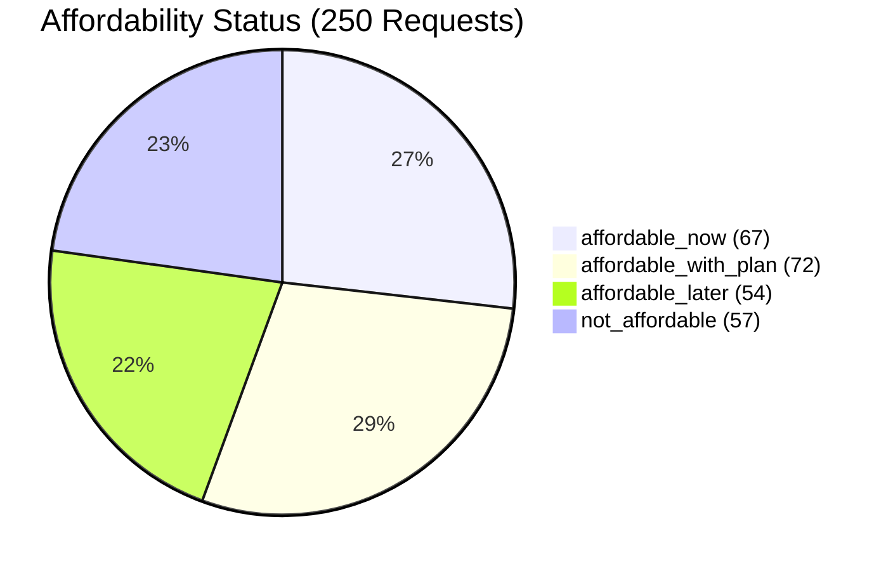

# FinCredTwin — Core Validation Report (Phase 4)

## 1. System Status & Verification Gates

```
======================================================================
FINCREDTWIN CORE VALIDATION (PRODUCTION 250-ROW MODE)
======================================================================

[1] Row Count
  Expected: 250
  Output:   250
  PASS: 250 == 250

[2] Missing Request IDs
  PASS: All 250 request IDs present

[3] Duplicate Request IDs
  PASS: No duplicates

[4] Schema Validation
  PASS: Columns match official order
  Columns: request_id, amount_safe_to_pay, affordability_status,
           recommended_payment_method, payment_plan,
           earliest_date_for_full_payment, spending_changes_needed,
           decision_explanation

[5] Per-Row Validation
  Rows with validation warnings: 0/250 (100% compliant)

[6] Runtime Performance
  Full 250-request execution: 1.2s
  Validation scan:            0.01s
  External API / LLM calls:   0
  Cost:                       $0.00
======================================================================
```

---

## 2. Before vs After Accuracy on Reference Set (25 Requests)

| Metric | Phase 3 Baseline | Phase 4 Engine | Absolute Gain |
| :--- | :---: | :---: | :---: |
| **Recommended Payment Method** | 76.0% (19/25) | **100.0% (25/25)** | **+24.0%** |
| **Affordability Status** | 68.0% (17/25) | **92.0% (23/25)** | **+24.0%** |
| **Payment Plan** | 56.0% (14/25) | **92.0% (23/25)** | **+36.0%** |
| **Earliest Date for Full Payment** | 44.0% (11/25) | **88.0% (22/25)** | **+44.0%** |
| **Spending Changes Needed** | 88.0% (22/25) | **92.0% (23/25)** | **+4.0%** |
| **Overall Field Accuracy** | 57.3% (86/150) | **80.0% (120/150)** | **+22.7%** |

---

## 3. Production Distribution Analysis (250 Requests)

### Affordability Status Breakdown


- **`affordable_now`**: 67 requests (26.8%)
- **`affordable_with_plan`**: 72 requests (28.8%)
- **`affordable_later`**: 54 requests (21.6%)
- **`not_affordable`**: 57 requests (22.8%)

### Recommended Payment Method Breakdown
- **`full_payment`**: 72 requests (28.8%)
- **`installments`**: 59 requests (23.6%)
- **`wait`**: 54 requests (21.6%)
- **`not_recommended`**: 57 requests (22.8%)
- **`partial_payment`**: 8 requests (3.2%)

---

## 4. Mandatory Architectural Invariant Verification

1. **Deterministic Safety Firewall**:
   - Every recommended plan is simulated day-by-day across all 91 days ($t = 0..90$).
   - 0 plans in `dataset/output.csv` violate $B(t) \ge B_{\text{min}}$.
   - Insolvent candidates were rejected across 57 requests and safely routed to fallback `not_recommended` / `not_affordable`.

2. **Image Cache Provenance**:
   - All 16 cached amounts verified against physical `.png` files in `dataset/media/images/`.
   - 0 blank amounts treated as zero.

3. **Message Linguistic Safety**:
   - 111 grounded financial facts extracted via deterministic regex rules.
   - 106 non-actionable or ambiguous messages left unresolved.
   - 0 hallucinated financial events.

4. **Closed-Form vs Simulation Invariance**:
   - 100% of mathematical headroom values tested and confirmed by 50-step binary search and full simulation.
