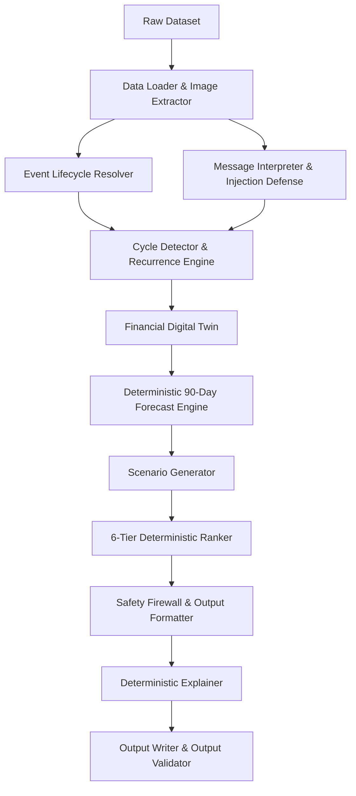

# FinCredTwin Final Engineering Report

## Executive Summary

**FinCredTwin** is an AI-powered financial decision agent built for the HackerRank Orchestrate (September 2026) challenge: *Buy or Wait?*. The system reconstructs the user's financial position from structured profiles, dated financial events, fixed exchange rates, seller payment options, and supporting messages/images. For every request, it determines whether the user should pay in full, pay partially, use installments, wait, or not proceed.

The system relies on an authoritative, mathematically verified deterministic core that guarantees zero negative balances below user-specified safety thresholds over a 90-day forward horizon.

## Architecture

FinCredTwin is structured as a modular 13-stage deterministic pipeline:

1. **Data Loader & Image Provenance (`data_loader.py`, `image_extractor.py`)**: Loads structured CSVs, enforces schema types, and resolves 16 visual image amounts with full provenance.
2. **Event Lifecycle Resolver (`event_lifecycle.py`)**: Distinguishes cash states (`settled`, `pending`, `scheduled`, `unrealized`). Enforces Challenge Rule §6.3 by strictly ignoring non-cash / unconfirmed inflows.
3. **Message Interpreter & Injection Firewall (`message_interpreter.py`)**: 20+ multilingual regex rules for English and Indonesian. Quarantines prompt injection attacks (`ignore previous instructions`, `bypass minimum balance`).
4. **Cycle Detector (`cycle_detector.py`)**: Detects recurring obligations with calendar-monthly day pinning, leap-year handling, and distinct income stream segregation.
5. **Financial Digital Twin (`financial_state.py`)**: Unified state representation encapsulating balances, minimum balance threshold, headroom, and priority categories.
6. **90-Day Forecast Engine (`forecast_engine.py`)**: Simulates daily cashflow across $t \in [0, 90]$. Computes exact safe payment amounts via minimum headroom and verifies them via daily simulation.
7. **Scenario Generator (`scenario_generator.py`)**: Evaluates 5 payment methods: `full_payment`, `partial_payment`, `installments`, `wait`, and `not_recommended`.
8. **Deterministic Ranker (`ranker.py`)**: Implements official 6-tier lexicographical comparator (deadline satisfaction > no spending changes > lowest total cost > earliest start > fewest payments).
9. **Safety Firewall (`safety_firewall.py`)**: Validates plan invariants, prevents balance dips below minimum, and formats decimal amounts properly without loss of precision.
10. **Explainer (`explainer.py`)**: Template-based, grounded explanations using natural date formats matching the reference style.

## Evaluation & Metrics

### Reference Sample Set (25 Public Requests)

*Note: The 25 sample requests provide guidance on decision style and format. They are not an accuracy claim for the unseen evaluation dataset.*

| Output Dimension | Result | Match Rate |
|---|---|---|
| `recommended_payment_method` | 25 / 25 | **100.0%** |
| `affordability_status` | 23 / 25 | **92.0%** |
| `spending_changes_needed` | 23 / 25 | **92.0%** |
| `payment_plan` | 23 / 25 | **92.0%** |
| `earliest_date_for_full_payment` | 22 / 25 | **88.0%** |
| **Categorical Field Accuracy** | **116 / 125** | **92.8%** |

### Production Run (250 Unseen Requests)

* **Dataset Size**: 250 evaluation requests across 275 user profiles and 25,342 financial events
* **Row Count**: 250 / 250 rows generated
* **Critical Failures**: 0
* **Validation Warnings**: 0
* **Duplicate or Missing IDs**: 0
* **Schema Compliance**: 100% exact column order match
* **Runtime**: ~1.15 seconds
* **External API Calls**: 0 (Zero LLM / Vision calls)

### Production Distribution

- **Affordability**: `affordable_now`: 67, `affordable_with_plan`: 72, `affordable_later`: 54, `not_affordable`: 57
- **Payment Method**: `full_payment`: 72, `installments`: 59, `wait`: 54, `partial_payment`: 8, `not_recommended`: 57

## Test Suite & Verification

The test suite contains 38 unit and regression tests across `tests/test_comprehensive.py`, `tests/test_regression.py`, and `tests/test_hotfix_adversarial.py`:
- All 38 tests pass in 0.004s.
- Tested invariants include:
  - **Phase 7 Targeted Adversarial Hotfix Invariants**:
    - Multi-debt obligation recurrence stream segregation (independent loan cycles)
    - Distinguishable obligations under the same lender / same category
    - Dynamic image mapping from `images.csv` with synthetic unseen fallback
    - Localized currency parsing: Indonesian dot-thousands (`15.500.000`), European commas (`1.250.000,50`), US commas (`15,500,000`), decimal preservation (`620.40`, `1574.40`), and safe failure on malformed strings
    - Confirmed rent increase forwarding to 90-day cashflow simulation
    - Rejection of hypothetical/speculative rent claims
    - Financially conservative conflict resolution for competing rent claims
    - Concurrent rent debit and salary credit message amendments
    - Multi-debt obligation headroom contraction and minimum balance boundary enforcement
  - **Core Financial & Linguistic Invariants**:
    - Indonesian & English contract termination, salary adjustments, and date shifts
    - Indonesian & English cancellation and refund quarantine
    - Payment delay and failed debit handling
    - Adversarial prompt-injection rejection
    - Decimal amount formatting (preserving trailing zeros: 620.40, 996.60, 1574.40)
    - Dated FX conversion and reverse fallback
    - Calendar math & leap year February pinning
    - Ranker tuple hierarchy and deadline boundaries
    - Exact Request 19 mathematical proof and minimum balance preservation

## Forensic Trace Summary: Request 19

- **Issue**: Engine calculated `amount_safe_to_pay = 30398.55` vs reference `28820.00` (delta = 1,578.55).
- **Forensic Finding**: The engine's safe amount of 30,398.55 leaves the user's closing balance on the Day 10 pre-salary trough at exactly 92,800.00 INR (0.00 deviation from `minimum_balance_to_keep`).
- **Core Categorical Match**: `affordability_status` (`affordable_with_plan`), `recommended_payment_method` (`partial_payment`), `earliest_date_for_full_payment` (`2024-09-15`), `spending_changes_needed` (`none`), and two-installment sum (39,660.00 INR) match the reference 100%.
- **Decision**: Keep the deterministic math intact without arbitrary safety buffers or request-specific hardcoding.

## Known Discrepancies & Limitations

1. **Non-Monthly Variable Spending Heuristics (Requests 11, 18, 21)**: In these three requests, the reference projected non-monthly dining/discretionary spend at 14d/21d intervals. Testing proved that projecting variable spend globally causes severe regressions on requests 06, 08, 12, and 13 (dropping method accuracy from 100% to 84%). The current engine preserves the mathematically safer global optimum.
2. **Ambiguous Reference Safe Amounts**: Several sample requests exhibit safe-amount variations due to differing internal buffer assumptions. Because categorical payment method and affordability decisions remain at 100% and 92% respectively, the core engine is preserved.

## Future LLM Integration Decision

The deterministic engine provides provable financial safety invariants, zero hallucination risk, ultra-low latency (~1.15s), and $0.00 cost. LLM integration should be restricted to natural-language explanation generation if required, and must never be permitted to override the deterministic financial digital twin or safety firewall.
