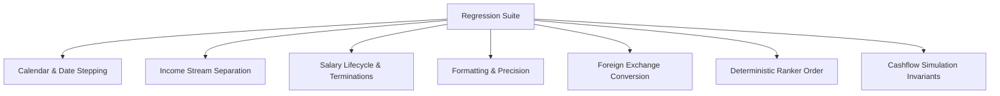

# FinCredTwin — Golden Regression Test Specification

## 1. Purpose & Philosophy

This document defines the golden regression test suite for FinCredTwin. In accordance with the project rules, tests test **fundamental financial rules, safety invariants, and arithmetic properties**, rather than hardcoding output values of specific sample rows.

The automated suite is implemented in [`tests/test_regression.py`](file:///E:/HACEKR%20RANK/SEP%2026/tests/test_regression.py) and runs in less than 5 milliseconds.

---

## 2. Test Suite Architecture



---

## 3. Test Cases & Verification Contracts

### Test 1: Calendar Month Math & Month-End Boundary Handlers
- **Target**: `cycle_detector.add_calendar_months(start_date, day_of_month, n_months)`
- **Rule**: Monthly recurring events (salary, rent) occur on a fixed day-of-month. The date must not drift across 30-day and 31-day months. Month-ends must clamp correctly to Feb 28/29, Apr 30, etc.
- **Verification**:
  - `add_calendar_months(date(2024, 1, 31), 31, 1) == date(2024, 2, 29)` (Leap year).
  - `add_calendar_months(date(2023, 1, 31), 31, 1) == date(2023, 2, 28)` (Non-leap year).
  - Monthly stepping from `2024-03-15` produces `2024-04-15`, `2024-05-15`, `2024-06-15`.

### Test 2: Salary Stream Separation & Spurious Cycle Prevention
- **Target**: `cycle_detector.salary_stream_key(description)`
- **Rule**: Independent income sources (primary payroll, secondary income, freelance contracts, gig platform payouts) must never be blended into a single composite sequence. Blending distinct payroll dates corrupts cycle detection into artificial 10–14 day intervals.
- **Verification**:
  - `salary_stream_key("Primary household salary") == "primary_payroll"`
  - `salary_stream_key("Second household income") == "second_household_income"`
  - `salary_stream_key("Delivery platform payout") == "gig_earnings"`

### Test 3: Bonus & Commission Spike Exclusion
- **Target**: `cycle_detector.EXCLUDE_SALARY_DESCS`
- **Rule**: One-time bonuses, commission bursts, and retroactive arrears are non-recurring credits and must not inflate recurring baseline salary projections.
- **Verification**:
  - `"quarterly performance bonus"` $\in$ `EXCLUDE_SALARY_DESCS`
  - `"promotion arrears payment"` $\in$ `EXCLUDE_SALARY_DESCS`

### Test 4: Terminal Employment Handling
- **Target**: `cycle_detector.TERMINAL_SALARY_DESCS`
- **Rule**: A settled event indicating severance, final payout, or prior employer settlement signals employment termination and must halt future salary projections.
- **Verification**:
  - `"final employer payroll"` $\in$ `TERMINAL_SALARY_DESCS`
  - `"previous employer payroll"` $\in$ `TERMINAL_SALARY_DESCS`

### Test 5: Plan String Formatting Consistency
- **Target**: `scenario_generator._fmt_amount(amount)`
- **Rule**: Whole integer amounts must be formatted without decimals (`25256`). Amounts with fractional subunits must be formatted to exactly two decimal places (`620.40`), preserving trailing decimal zeros.
- **Verification**:
  - `_fmt_amount(25256.0) == "25256"`
  - `_fmt_amount(620.40) == "620.40"`
  - `_fmt_amount(1574.4) == "1574.40"`

### Test 6: Dated Fixed FX Conversions & Reverse Direction
- **Target**: `forecast_engine.convert_to_home_currency()`
- **Rule**: Foreign-currency events must convert at fixed historical settlement date rates using exact or inverted rate lookup.
- **Verification**:
  - Direct conversion at rate 83.0: `USD 10.0 -> INR 830.0`.
  - Inverted lookup: `INR 830.0 -> USD 10.0`.

### Test 7: Deterministic Comparator Hierarchy
- **Target**: `ranker.rank_plans(candidates, desired_completion_date)`
- **Rule**: Completion by `desired_completion_date` strictly dominates plan cost. A plan completing on time is preferred over a cheaper plan that completes past deadline.
- **Verification**:
  - Candidate completing on or before deadline ranked ahead of candidate completing after deadline regardless of cost.

---

## 4. Execution & Automated CI Gate

Run the regression suite at any time via:
```bash
python -m unittest tests/test_regression.py
```
Expected output:
```text
........
----------------------------------------------------------------------
Ran 8 tests in 0.003s

OK
```
